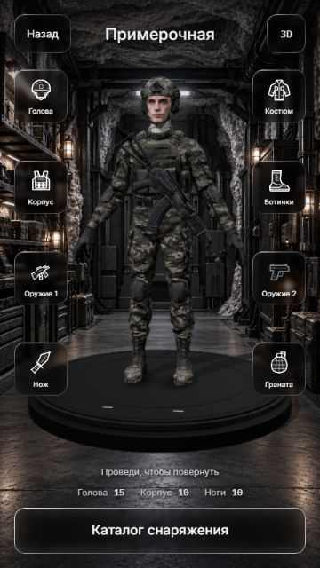

# Примерочная: сцена, иконки и каталог

Продолжение ветки `codex/weapon-screen-loader` после `ba5ab50`. Ветка объединена со свежим `origin/main`; push разрешён Артом 28 октября. Другой рабочий каталог Claude не изменялся.

## Текущая версия: ручная Персона, оригиналы Tripo, сборщик оружия

Каталог примерочной ограничен готовыми моделями: К-6, «Плита-2», полевой костюм, «Варяг», его заводские детали, Сокол и Тишина. Исключения по просьбе Арта — все ножи, гранаты и сапоги. Фильтр `model-catalog.ts` применяется к каталогу снаряжения, смене оружия и спискам обвесов. Полный каталог правил и ранее сохранённые комплекты не переписываются.

Просмотр оружия: горизонтальное движение вращает его, вертикальное наклоняет в плоскости экрана. Наклон работает и при взгляде сбоку, позволяя выровнять ствол горизонтально. То же управление доступно стрелками. Проверено в браузере без звука: [горизонтальный ракурс](screenshots/weapon-horizontal.jpg).

- Логотип на главной уменьшен вдвое целиком: знак 39×39 px, надпись и расстояние между ними тоже ×0,5.
- Персона в примерочной теперь целиком из сохранённого Артом `CrownedDogs-Fitting-FreeEdit.blend`: все пять объектов, их геометрия, материалы и положение. `blender/export_persona.py` экспортирует только коллекцию Персоны; игра больше не меняет её позу, размер и положение. Полученный GLB упакован в `preview/persona-authored.json` без изменения байтов. Автомат и ремень используют ранее перенесённые правки той же сцены.
- Для осмотра К-6, «Плиты-2» и полевого костюма подключены исходные `helmet.glb`, `vest.glb`, `suit-male.glb` из `C:\Users\qtas5\Documents\CrownedDogs\3d\04-armor\tripo`. Модели с Персоны больше не извлекаются. Все данные геометрии скопированы побайтно, без подгонки, новой позы и упрощения. Текстуры — 2K WebP для браузера. У исходного костюма есть голова и кисти: оставлены как в Tripo. Подробности и контрольные суммы — [original-models.md](original-models.md).
- «Варяг» остаётся утверждённой отдельной игровой сборкой P2 Tripo с гнёздами; он не подгонялся под тело. Осмотр использует его исходную форму, а подвес из Blender применяется только в примерочной.
- По `angar-sol.html` и `READMEforgunz.md`: крупный 3D-ствол, пять точек на настоящих гнёздах, линии к кнопкам. Точки следуют за моделью при вращении. Нажатие точки или кнопки открывает короткий нижний список совместимых деталей. Характеристики открываются отдельно. Данные берутся из актуального каталога игры. Поворот сохраняется при смене детали; отдельные готовые 3D-детали есть у Сокола и Тишины, остальные пока меняют комплект и его свойства.

Проверки: 360×640 и ПК, оригиналы трёх предметов, ручная Персона, уменьшенный логотип, вращение гнёзд, установка Сокола и возврат исходного Блика, возврат из оружия, характеристики. Без звука. TypeScript, 122 теста и сборка проходят.

Превью: [главная](screenshots/home-logo-half-360x640.jpg), [Персона Арта](screenshots/persona-authored-360x640.jpg), [шлем](screenshots/tripo-helmet-360x640.jpg), [бронежилет](screenshots/tripo-vest-360x640.jpg), [костюм](screenshots/tripo-suit-360x640.jpg), [оружие](screenshots/weapon-sockets-360x640.jpg).

## Дополнение: логотип и осмотр предметов

- На главной — утверждённая пасть из двух корон и векторная надпись Crowned Dogs. Подпись места — «БАЗА ОПЕРАТОРА»; вводная фраза убрана.
- `item-viewer.ts` показывает самостоятельные исходники Tripo: К-6, полевой костюм, «Плита-2». `rifle-varyag` использует существующий `public/preview/varyag.json`. Исходные модели на диске не меняются.
- Модель вращается перетаскиванием и стрелками. В каталоге выбор сохраняет окно открытым и удерживает прокрутку. При открытии категории показывается надетый предмет с готовой моделью либо первый готовый предмет с явным названием; это не меняет комплект. У предметов без своей модели остаётся карточка.
- На экране Варяга объёмная модель заменяет SVG. Пять слотов работают; геометрия Сокола и Тишины подключена через готовые гнёзда. Другие оружие и обвесы пока сохраняют прежнее представление.
- Осмотр использует общие уровни качества, текстурные уровни, ACES и настройку материалов. Рендер идёт по запросу; скрытые просмотры не запускают цикл кадров, ресурсы освобождаются при закрытии владельца.
- Secondary — `#AEBBC5`: доступные невыбранные предметы и дополнительные тексты, без уменьшения прозрачности. Руки свободнее в локтях, кисти ближе к телу; автомат придвинут. У платформы карта износа, крепления к полу и контактная тень.
- Для ручной правки подготовлена отдельная копия Blender `../blender/CrownedDogs-Fitting-FreeEdit.blend` (от корня репозитория). Автомат, два карабина и кривая ремня независимы. Скрипты воспроизведения — в `blender/`; пользовательский файл не перезаписывается.

Проверено без звука: все четыре модели в браузере, поворот, переключение категорий, установка/снятие Сокола, возврат из оружия, размеры 390×844 и 360×640. Исходный комплект после проверки восстановлен. TypeScript, 122 теста и сборка прошли; ошибок браузера нет.

Превью: [главная](screenshots/home-logo.jpg), [каска](screenshots/item-helmet-3d.jpg), [бронежилет](screenshots/item-vest-3d.jpg), [костюм](screenshots/item-suit-3d.jpg), [Варяг](screenshots/item-varyag-3d.jpg).

## Ручные правки подвеса из Blender

Перенесена сохранённая пользователем сцена `../blender/CrownedDogs-Fitting-FreeEdit.blend`: положение и наклон автомата, трансформации обоих карабинов и точная поверхность отредактированного ремня. SHA-256 исходного файла: `47938393ec23c61390b4239bfb07e5ce539263e1ef96c6867c04d473504387ab`. Файл Blender прочитан без пересохранения; контрольная сумма после переноса совпадает.

`blender/export_user_fit.py` выгружает матрицу оружия и вычисленную геометрию ремня/карабинов в `apps/web/src/base/user-fitting-layout.json`. Учитываются переход Z-up → Y-up и высота постамента. Ремень сохраняет ручки кривой, наклон и профиль из Blender; вершины округлены до микрометра и индексированы. Всего 1 924 треугольника, JSON 84 КБ. Исходная геометрия автомата не изменена.

`user-fitting-layout.ts` применяет данные только к подвесу Варяга в примерочной. Осмотр предмета и боевая модель остаются самостоятельными. При повторной правке достаточно снова выполнить экспорт из сохранённого файла. Скрипт `inspect_edit.py` сравнивает исходную и редактируемую сцены без записи в них.

Проверено: корректность матрицы после разложения, индексов и координат геометрии; TypeScript и сборка прошли. В браузере без звука проверены вид спереди и поворот вместе с Персоной и платформой, ошибок консоли нет. Превью: [спереди](screenshots/fitting-authored-front.jpg), [при повороте](screenshots/fitting-authored-side.jpg).

## Что изменено

- 32 векторные иконки предметов, единая сетка 48×48 и одинаковая детализация. В игре используются inline SVG с `currentColor`; отдельные SVG и manifest лежат в [icons/](icons/manifest.json), обзор — [equipment-icons.html](equipment-icons.html). Повторная выгрузка: `node docs/fitting-upgrade/export-equipment-icons.mjs`.
- Единые внешние отступы кнопок — 16 px. Стрелка есть слева от «Назад», платформа вращается перетаскиванием или клавишами влево/вправо при фокусе на модели.
- Каталог использует собственный список слотов с тем же Liquid Glass. Он поддерживает клавиатуру, Escape и Tab. Системного select больше нет.
- Прокрутка — собственный тонкий ползунок поверх содержимого. Он не съедает ширину карточек: поля слева и справа по 16 px. Колесо, касание, клавиатура, клик и перетаскивание ползунка работают.
- Нет «Надеть», «Выбрано», «Установлено» и плюсов. У ненадетых предметов иконки серые, у надетых белые и галочка справа сверху. Это применяется и к спискам оружия/модов.
- Возврат из экрана оружия восстанавливает каталог, категорию и положение прокрутки, если оружие открыли оттуда. При входе через слот Персоны возврат ведёт в примерочную.

## Сцена

- Новый пустой фон [fitting-room-v2.png](../../apps/web/public/img/base/fitting-room-v2.png), создан встроенным imagegen. Цвет и материалы взяты из утверждённых референсов. Персона и платформа в фон не запечены. Промпт и исходные референсы — в [PROMPTS.md](PROMPTS.md).
- Настоящий 3D-постамент: неподвижное основание, металлический поворотный диск, крепёж и контактные тени. Диск, Персона и подвес оружия вращаются вместе. Прозрачный приёмник теней сохраняет пол нарисованной комнаты без стыка прямоугольного canvas.
- Руки отведены от корпуса в спокойной A-позе. Персона не проигрывает боевую стойку с оружием в руках.
- Подключён уже одобренный «Варяг» Claude, на двухточечном ремне. Это точная копия готового ассета в новой папке `public/preview`; источник и SHA-256 — в [varyag-provenance.md](varyag-provenance.md).
- Используются общие с боем `QUALITY/startQuality`, `TextureTiers`, настройка материалов `tune`, ACES, тени и лимиты разрешения. Освещение подстроено под светильники комнаты; отражения берутся из нового фона. В проверенном браузере профиль High, текстуры 2048. Полная Lens-постобработка арены не переносилась: она зависит от боевой камеры и задника.

Ограничения ассетов: броня пока отображается моделью Kit A, как и до этой задачи. Реальная модель есть у Варяга, включая Сокол/Тишину; остальные классы используют существующие боевые прототипы. Геометрия и текстуры исходных Персон не редактировались. Защищённые `apps/web/models/`, `packages/audio/assets/` и `packages/core/src/rules.ts` не изменены.

## Изменённые файлы

- `apps/web/src/base/equipment-icons.ts` — SVG-пак и варианты предметов.
- `base-screen.ts`, `base.css`, `weapon-screen.ts`, `weapon-screen.css` — интерфейс, навигация и состояния выбора.
- `glass-scroll.ts`, `glass-scroll.css` — общая прокрутка без системной полосы.
- `persona-viewer.ts`, `fitting-stage.ts` — объёмная сцена, поза, свет и подвес.
- `apps/web/public/img/base/fitting-room-v2.png`, `apps/web/public/preview/varyag.json` — новый фон и копия готового оружия.

## Проверка

```powershell
npm run check
npm run web:build
npm run dev -w @crowned-dogs/web -- --host 127.0.0.1 --port 5186 --strictPort
```

Открыть `http://127.0.0.1:5186/#fitting`. Проверки выполняются без звука.

1. Повернуть модель: меняются ракурс бойца, оружия и метки диска, основание остаётся неподвижным. Шлем и передняя кромка платформы помещаются в кадре.
2. Открыть любой слот: одна галочка у текущего предмета, остальные иконки серые. Подписи выбора отсутствуют.
3. Прокрутить каталог до конца новым ползунком. Через список слотов открыть «Оружие 1» и нажать «Назад»: возвращается та же категория и позиция прокрутки.
4. Проверить список с клавиатуры, короткий каталог «Оружие 2», экран модов, размеры 360×640 и ПК.

Выполнено: TypeScript и все 122 теста прошли. В браузере проверены 360×640 и 1280×800, поворот мышью и клавишами, прозрачный контакт с полом, поля карточек 16/16 px, перетаскивание ползунка до конца, возврат из оружия с восстановлением прокрутки 266 px, Escape/Tab в списке категорий и отсутствие обрезки короткого каталога на ПК. Ошибок консоли нет. SVG-пак: все 32 файла разобраны как XML; manifest соответствует реальным слотам (вторым оружием может быть только пистолет). Проверка окна телефона не заменяет тест на физическом устройстве.

## Превью

- [Примерочная на телефоне](screenshots/fitting-360x640.jpg)
- [Поворот платформы](screenshots/fitting-rotated-360x640.jpg)
- [Каталог](screenshots/catalog-360x640.jpg)
- [Список слотов](screenshots/dropdown-360x640.jpg)
- [Примерочная на ПК](screenshots/fitting-desktop.jpg)
- [Полный набор иконок](equipment-icons-preview.jpg)


