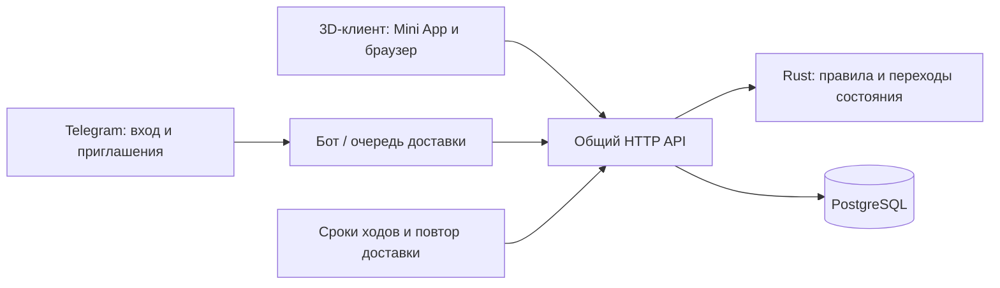

# Онлайн Crowned Dogs: первый рабочий выпуск

Решения владельца, 6 ноября 2026: бой проходит в существующей 3D-игре (Telegram Mini App и сайт), вход открыт любому игроку через Telegram, прогресс начинается с нового серверного профиля. Потолок первого выпуска — **4 уровня**. Старый локальный прогресс не импортируем как заработанный.

## Что игрок должен получить

1. Открывает бота/игру, подтверждает Telegram-вход, получает постоянный профиль и уникальный жетон.
2. Настраивает Персону, выбирает доступное снаряжение, распределяет очки. После закрытия игры всё сохраняется.
3. Нажимает «Вызвать на дуэль». Бот публикует карточку в подключённом игровом чате: имя, `@username`, уровень, жетон и кнопку входа. Если username отсутствует, показывается Telegram-имя; идентичность всегда определяется ID.
4. Другой игрок открывает приглашение, видит условия и подтверждает участие. Открытие ссылки само по себе не принимает вызов.
5. Оба загружают 3D и подтверждают готовность. Только затем начинается таймер первого хода.
6. Игрок выбирает приказ. Сервер подтверждает его приём и ждёт второго игрока; текущий чужой приказ скрыт.
7. Сервер рассчитывает ход. Оба клиента показывают один и тот же результат со своей стороны.
8. После боя сервер один раз начисляет опыт и мастерство, сохраняет итог. Повторный вход показывает тот же профиль.

Открытый доступ к игре не означает право публиковать вызовы во все чаты бота. Для первого выпуска используются явно подключённые игровые группы; публикация начинается по действию игрока.

## Что уже есть и чего не хватает

Состояние исходников: `afeada0945ae69f84cd3d9437d6edc3b203e25ef`.

| Уже есть | Нужно соединить или исправить |
|---|---|
| Rust-правила, два тайных приказа, PvP reducer `server.duels.step` | Транзакции, постоянные состояния, сетевые команды |
| 3D-арена, анимация `play_turn`, интерфейс выбора | Асинхронные ответы, ожидание соперника, обе стороны, восстановление |
| `syncFresh/syncSpend/syncApply/syncGain` | Прогресс в БД и применение обоих профилей на сервере |
| Telegram-бот и ссылки `/duel` | Групповые карточки, общий профиль с Mini App, доставка с повторами |
| Выдача жетонов | Уникальность между процессами и перенос прежних подтверждённых жетонов |

Сейчас память бота теряет бои при перезапуске; браузер сам рассчитывает противника и награды. Это две разные игры на одном ядре. Онлайн требует одного источника истины — сервера.

## Архитектура

Один API-процесс, PostgreSQL и фоновые обработчики достаточны для первого выпуска. Redis и отдельные микросервисы не нужны. Начальный транспорт — HTTP-команды и получение состояния по версии; WebSocket может ускорять уведомления, но не отвечает за сохранность боя.

Node выполняет проверку транспортных credentials, HTTP, SQL и Telegram API. Rust сохраняет правила боя, допустимость снаряжения, расчёт параметров, переходы приглашения/боя, сроки, публичную проекцию и награды. Формулы не дублируются в TypeScript.

## Профиль и прогресс

- Неизменяемый Telegram ID — привязка аккаунта; `username` может меняться и отсутствовать.
- Уникальный внутренний ID, постоянный жетон, актуальное Telegram-имя и игровой позывной — разные поля.
- Новый профиль: уровень 1, опыт 0, начальные очки и мастерство из существующего Rust-каталога. Максимум — 4.
- Сохраняются распределённые очки мощности/охлаждения/инстинкта/рефлексов, свободные очки, мастерство классов оружия, внешность и проверенное снаряжение.
- Клиент отправляет намерения («вложить очко», «выбрать предмет»), а не готовые уровень, урон или результат.
- Бой получает неизменяемый снимок обоих профилей, снаряжения и версии правил. Переодевание в другом окне не меняет начатый бой.
- Уровень/опыт и мастерство начисляются только за завершённый сервером бой, одной транзакцией вместе с итогом.
- На 4-м уровне лишний опыт не накапливается, как уже предусмотрено текущим правилом достижения потолка. Мастерство остаётся по существующей ограниченной кривой; изменение его правил — отдельное решение о балансе.
- Качество графики, громкость и кэш остаются настройками устройства.

Формат жетона `K-ППП-ННН` сейчас вмещает 999 регистраций в месяц. До расширения формата переполнение должно давать понятный отказ и сигнал оператору, никогда не повторный жетон. Перед широким набором игроков требуется отдельно утвердить расширение нумерации.

## Данные PostgreSQL

| Сущность | Ответственность |
|---|---|
| operators / profiles | Telegram ID, имя, жетон, прогресс, внешность, снаряжение, версия |
| tag_counters | Транзакционная выдача следующего жетона |
| sessions | Хеш случайной серверной сессии, владелец, срок, отзыв |
| invites | Автор, группа, срок, статус, принявший, бой, ID сообщения |
| matches / match_players | Закрытый Rust snapshot, обе стороны, готовность, срок хода, версия правил, итог |
| command_receipts | Ключ повтора, хеш запроса, сохранённый ответ; повтор не выполняет команду дважды |
| reward_ledger | Уникальная награда `(бой, игрок)` |
| outbox | Отправка/обновление Telegram-карточки после commit, попытки и ошибки |

Таблицы вводятся по этапам, без пустых заготовок на все будущие функции.

Команда обрабатывается под транзакционной блокировкой: серверная сессия → проверка повтора → загрузка и блокировка данных → проверка времени → Rust transition → запись состояния/результата/outbox → commit → ответ. Ошибка Rust откатывает всю операцию.

## Честность и восстановление

- Сервер не отправляет браузеру `seed`, `rng`, чужой текущий приказ/черновик и внутренний snapshot. Используется явный список разрешённых полей. Прошедший ход раскрывается в отчёте согласно правилам журнала.
- Текущий `press` переключает выбор: повтор по сети способен его отменить. Поэтому необходимы `commandId`, версия и сохранённый ответ на повтор.
- При двух одновременных принявших создаётся ровно один бой. Один игрок не занимает два активных боя.
- `loading` ограничен отдельным сроком. Если один не загрузился, бой отменяется без поражения/награды. Боевой таймер начинается после готовности обоих.
- Срок хода проверяется сервером внутри транзакции, а не только таймером процесса. Открытое меню и свёрнутый Telegram время не останавливают.
- После обрыва клиент запрашивает состояние. Потерянный ответ не считается потерянной командой.
- После рестарта сервер восстанавливает приказы, разрешает не более одного уже просроченного хода и назначает следующий срок от текущего времени. Не проигрывает несколько AFK-ходов мгновенно за период простоя.
- В истории остаются завершённый бой и обе награды. Повторное открытие итогов ничего не начисляет.
- Telegram-доставка допускает повтор одного и того же приглашения при сбое между отправкой и сохранением message ID. У такого повтора один token; второй бой не создаётся. Строго однократную видимую отправку обещать нельзя.
- Обновление несовместимых правил — после завершения активных боёв либо с явной миграцией состояния. У каждого боя фиксируется ruleset.

## Telegram и обычный браузер

Mini App передаёт `initData`, подпись и возраст проверяет сервер; `initDataUnsafe` и URL-параметр не удостоверяют игрока. После проверки выдаётся короткоживущая отзываемая серверная сессия. Секрет бота никогда не попадает в сборку.

В группе используется URL-кнопка на прямую Mini App-ссылку с token приглашения. Поле `web_app` у обычной inline-кнопки поддерживается только в личном чате с ботом. Для `startapp` потребуется настроенный Main Mini App в BotFather. На сайте вне Telegram нужен отдельный подтверждённый Telegram-вход; отсутствие `initData` не включает доверенный гостевой аккаунт.

Нужны ограничения частоты входов/команд/публикаций, проверка размера запросов, защита сессии и запрет чтения чужого боя. В логах нет токенов, `initData`, приватных приказов и строк подключения.

## Этапы реализации

1. **Общий аккаунт и хранилище.** PostgreSQL, миграции, проверка Telegram-входа, сессии, постоянный профиль и жетон, потолок 4. Отдельный запускаемый API без подключения к живому боту.
2. **Постоянный PvP-сервер.** Переходы Rust над БД, приглашения, слоты игроков, загрузка/готовность, таймеры, версии, повторы, сохранение итогов и наград.
3. **Сетевой 3D-клиент.** Вход, загрузка серверного профиля, remote duel, обе стороны, ожидание, reconnect, реальные имена/жетоны, применение внешности обоих. Особенно проверить двух Персон одинакового пола: сейчас они делят изменяемые материалы.
4. **Вызовы в Telegram.** Подключение группы, карточка и кнопка, принят/отменён/истёк, outbox; новые маршруты используют ту же базу и API, старый in-memory бой не остаётся вторым источником прогресса.
5. **Первый выпуск.** Перенос прежних доверенных операторов без сброса жетонов, отдельная БД и сервис на VPS, резервирование, восстановление, проверки двумя реальными аккаунтами. Публичное включение только после проверки целого пути.

Именно этапы 1–5 вместе дают играбельный онлайн. Готовность базы или API сама по себе ещё не означает готовность PvP.

## Приёмка первого выпуска

- Два разных Telegram-аккаунта проходят путь от приглашения до одинакового результата в 3D.
- Профиль и жетон сохраняются после выхода, нового устройства и рестарта сервера.
- Уровень не превышает 4; серверные параметры обоих влияют на бой через существующее ядро.
- Два гостя одновременно, два окна одного игрока, повтор запроса, поздний ход и гонка с таймером не удваивают действие/бой/награду.
- Первый приказ переживает перезапуск до второго приказа.
- Потеря ответа, сон телефона и перезагрузка страницы восстанавливают текущий бой.
- Подмена уровня, награды, игрока, предметов и случайности отвергается.
- Медленная загрузка 3D не расходует боевые ходы.
- Одинаковый пол Персон и сторона 1 корректно отображаются.
- Сбой Telegram не уничтожает сохранённый вызов или бой.
- Резервная копия восстановлена в чистую БД и проверена. Допустимая потеря данных и время восстановления зафиксированы отдельно; ежедневный dump не означает нулевую потерю.

## Источники и границы

- [Telegram: проверка initData](https://core.telegram.org/bots/webapps#validating-data-received-via-the-mini-app).
- [Telegram: прямые ссылки Mini App](https://core.telegram.org/bots/webapps#direct-link-mini-apps).
- [Telegram: InlineKeyboardButton](https://core.telegram.org/bots/api#inlinekeyboardbutton).
- [PostgreSQL: блокировки](https://www.postgresql.org/docs/current/explicit-locking.html).
- `crates/game-client/src/server.rs`, `crates/game-core/src/sync.rs`, `crates/game-core/src/tag.rs`.
- `crates/game-wasm/src/browser/{server_runtime,server_bot,battle,platform,app,arena}.rs`.

Документ фиксирует целевой продукт и порядок работ, а не утверждает, что всё перечисленное уже реализовано.
