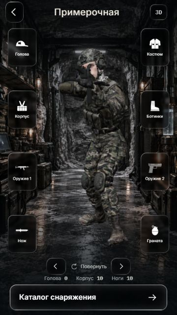

# Экран оружия и загрузка боя

Ветка: `codex/weapon-screen-loader`. Создана от актуального `origin/main` (`59d4708`), затем fast-forward до уже перенесённой базы `origin/claude/base-fitting-room` (`705e23e`). Последующий коммит содержит задачи 1–2 и исправление Liquid Glass. Push не выполнялся.

## Что сделано

- `Оружие 1` в примерочной открывает отдельный экран `#weapon`: крупный составной силуэт из существующего пакета иконок, пять гнёзд с привязкой к реальным точкам оружия. Для пистолета вместо приклада показана рукоять.
- Нажатие гнезда открывает нижнюю панель совместимых модов из core. Выбор меняет силуэт, сохраняется в локальном комплекте и учитывается в бою. Штатная деталь снимает только мод своего гнезда. Другие вещи и второе оружие сохраняются.
- Характеристики открываются только кнопкой `i`. Указаны условия расчёта: 7 шагов, обычное попадание в корпус без брони, щита и погоды.
- От нажатия `В бой` до `arena.ready` виден загрузчик с анимированной пастью из `assets/brand/loader/`. Таймер боя запускается после готовности арены и завершения исчезновения загрузчика. Есть возврат на базу, ошибка и повтор. Позднее завершение отменённой загрузки не запускает бой.
- Меню, примерочная, экран оружия и кнопки загрузчика используют **тот же** `.glass` и `hud/liquid.ts`, что бой. Панели переиспользуют `.sheet.glass`. В Chromium проверены реальные `url(#lg…)`-фильтры, чёрный фон 60%, blur 2px на кнопках и blur 12px на панелях. Отдельная имитация стекла удалена.

## Файлы

- `apps/web/src/base/weapon-screen.ts`, `weapon-screen.css` — новый экран и панели.
- `apps/web/src/base/loadout-state.ts`, `apps/web/test/loadout-state.test.ts` — выбор модов, совместимость, сохранение и проверки.
- `apps/web/src/base/base-screen.ts`, `base.css` — переход из примерочной и общий Liquid Glass.
- `apps/web/src/loading/*`, `apps/web/test/battle-loading.test.ts` — загрузчик и проверка его жизненного цикла.
- `apps/web/src/entry.ts`, `main.ts` — маршруты, ожидание готовности арены и запуск боя.
- `apps/web/public/brand/` — копия утверждённой пасти (JSON с GLB), SVG fallback и существующий контур надписи.

Модели в `apps/web/models/`, аудио в `packages/audio/assets` и баланс `packages/core/src/rules.ts` не изменены. Оружие здесь пока силуэт, без новых 3D-моделей.

## Проверка

```powershell
npm ci
npm run check
npm run web:build
npm run dev -w @crowned-dogs/web -- --host 127.0.0.1 --port 5186 --strictPort
```

Открыть `http://127.0.0.1:5186/#fitting`. В тестовой игре выключить «Звук боя и рации» в меню боя; дальнейшие проверки выполнять без звука.

1. Нажать `Оружие 1`. Проверить четыре вида оружия и пять гнёзд; цифры до нажатия `i` отсутствуют.
2. Для автомата выбрать прицел «Сокол», обновить страницу: выбор остаётся. В характеристиках точность на 7 шагах — 82%. Вернуть открытый прицел: 80%. Остальное снаряжение сохраняется.
3. Вернуться на базу и нажать `В бой`: пасть видна во время загрузки, затем открывается арена. Отменить новую загрузку кнопкой `На базу`: поздний ответ не должен возвращать в бой.
4. Проверить 360×640 и ширину ПК; панели прокручиваются, кнопка закрытия остаётся видимой.

Проведено: TypeScript и 122 теста прошли; сборка Vite прошла; `git diff --check` чистый. Проверены в браузере 360×640 и 1280×800, все четыре силуэта, сохранение мода после обновления, возврат штатной детали, открытие характеристик, холодная загрузка боя, возврат и отмена загрузки. Ошибок в консоли при проверке боя нет. Ошибка/повтор загрузки проверены автоматическими тестами; искусственный сетевой сбой в браузере не создавался. Это проверка адаптивного окна, не физического телефона.

## Скриншоты

- [Примерочная 360×640](screenshots/fitting-360x640.jpg)
- [Меню 360×640](screenshots/base-360x640.jpg)
- [Оружие 360×640](screenshots/weapon-360x640.jpg)
- [Моды 360×640](screenshots/mods-360x640.jpg)
- [Загрузчик 360×640](screenshots/loader-360x640.jpg)
- [Оружие на ПК](screenshots/weapon-desktop.jpg)


